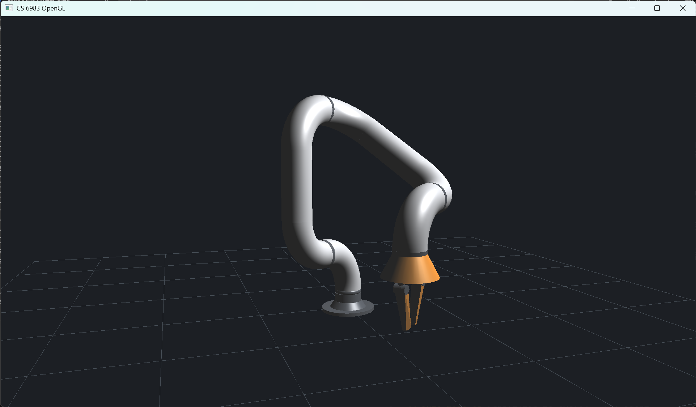

## Q1
First, I think the most challenging part was the OBJ loader. This is because face indices are global and start at 1. My solution was to maintain a single position table and a single normal table for the entire file. Finally, I verified the loader’s accuracy by comparing its output with the counts in the file.
## Q2
Throughout this process, I gained insights in the following areas. First, I became familiar with how to use Blender and gained an understanding of the process from modeling to actually adding lighting and shadows using code.
## Q3
 The vertex shader runs once for each vertex and determines the vertex's position in the actual rendered image. The fragment shader runs once for each pixel and determines the pixel's color.
## Q4
This is because in real-world training scenarios—such as training a robot—you still need to load the robot’s mesh model and render it. Keeping parts separate in Blender also allows for the potential addition of skeletons and joints later on.

